<p align="center">
  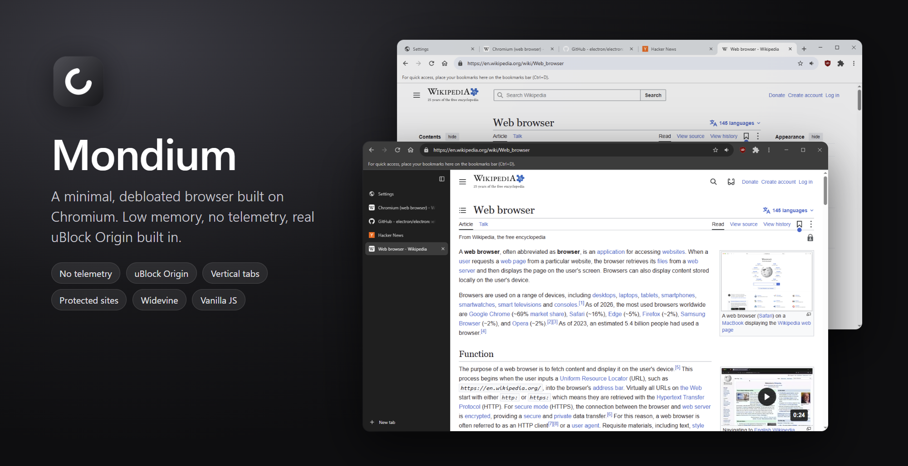
</p>

<h1 align="center">Mondium</h1>

<p align="center">
  <b>A minimal, debloated, Chromium-based desktop browser.</b><br>
  No accounts, no telemetry, no bloat. Just a fast, quiet browser that respects your RAM and your privacy.
</p>

<p align="center"><a href="#türkçe">Türkçe açıklama aşağıda ↓</a></p>

<p align="center">
  
  
  
  
</p>

---

## Why Mondium

Modern browsers ship with sync, telemetry, shopping assistants, AI sidebars, sponsored tiles and a dozen background services. Mondium keeps the Chromium engine and drops the rest.

- **Debloated.** No sign-in, sync, crash reporting, Safe Browsing pings, translation service, Privacy Sandbox, Topics or FLEDGE. No `X-Client-Data` header.
- **Light on memory.** Background tabs load only when opened, unused tabs go to sleep, and the UI is drawn in a single view with no extra processes.
- **Private by default.** Real uBlock Origin built in, DNS-over-HTTPS, Do Not Track + Global Privacy Control, WebRTC IP leak protection.
- **Hardened.** Full site isolation, sandboxed UI, verified extension packages and a local malicious-site warning. See the [security notes](docs/security-hardening.md).
- **Minimalist design.** Chrome-familiar layout, without the logos. 22 themes, pitch-black mode, vertical tabs. English and Turkish UI.
- **Vanilla JS.** The whole UI is plain HTML, CSS and JavaScript. No framework, no bundler, no TypeScript build step.

## Screenshots

| Vertical tabs | Classic tabs |
|---|---|
| 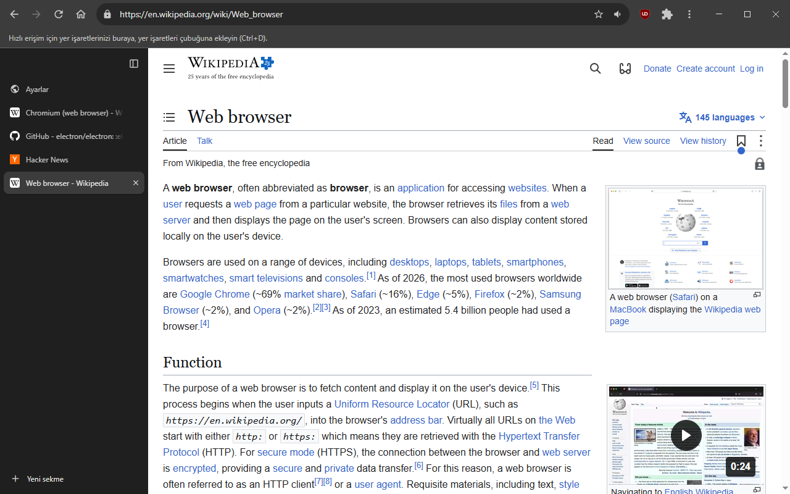 | 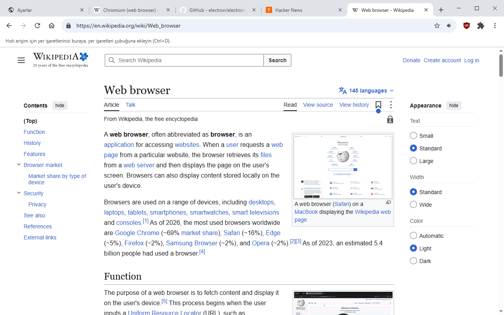 |

| New tab | Customizable clock |
|---|---|
| 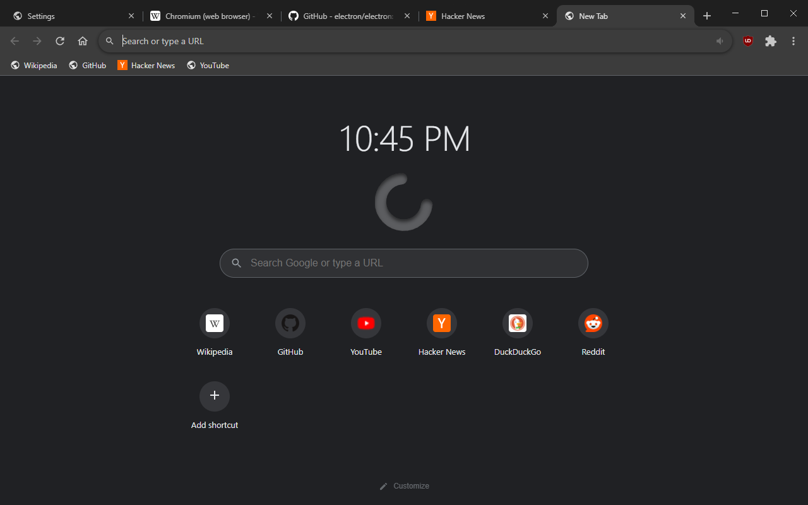 | 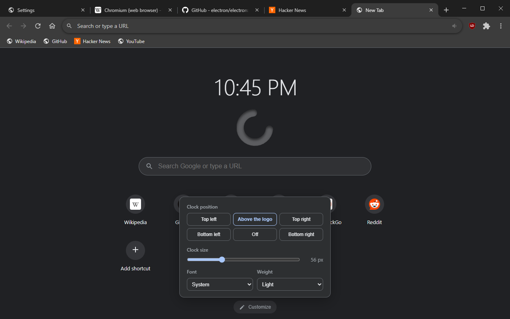 |

| 22 themes | Ocean theme |
|---|---|
| 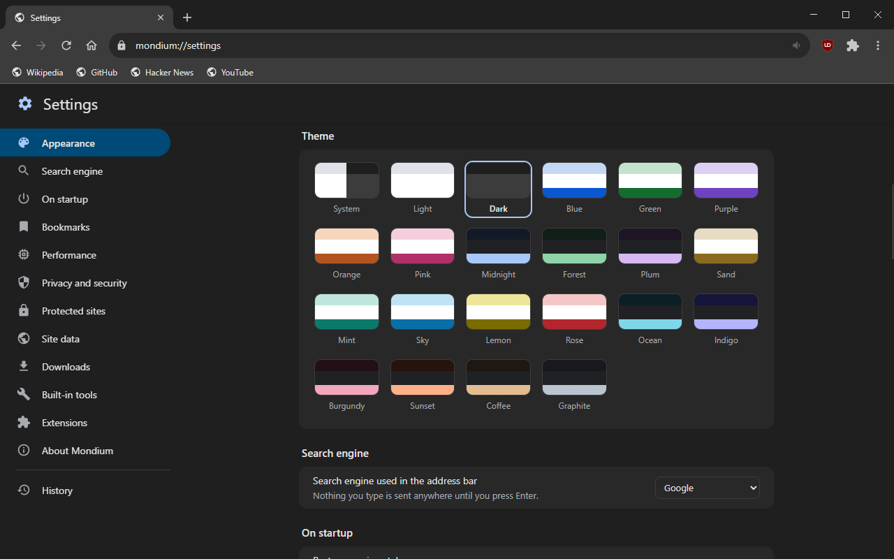 | 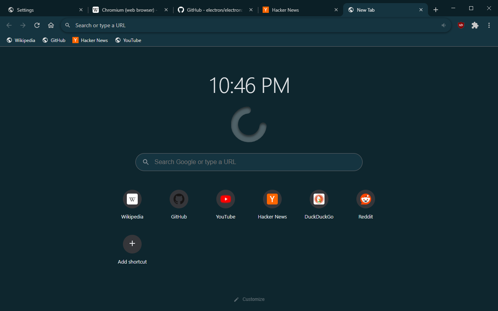 |

| Protected sites | Clear browsing data |
|---|---|
| 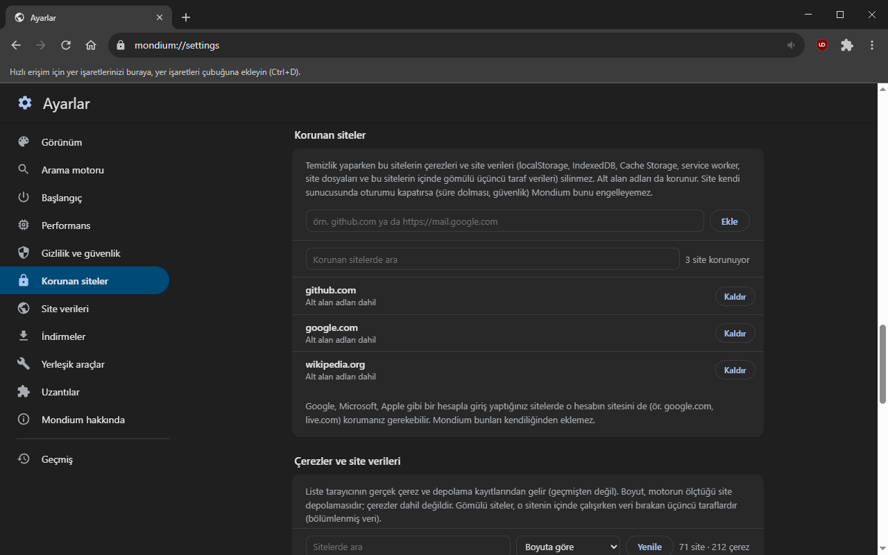 | 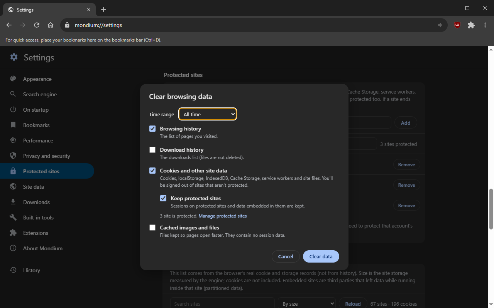 |

| Task manager | Built-in volume booster |
|---|---|
| 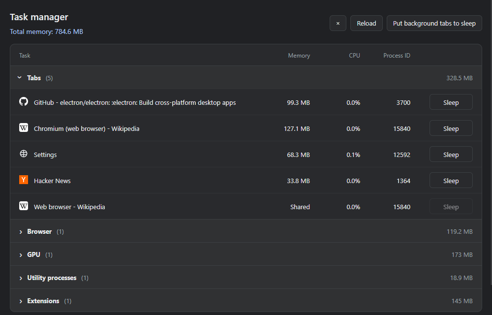 | 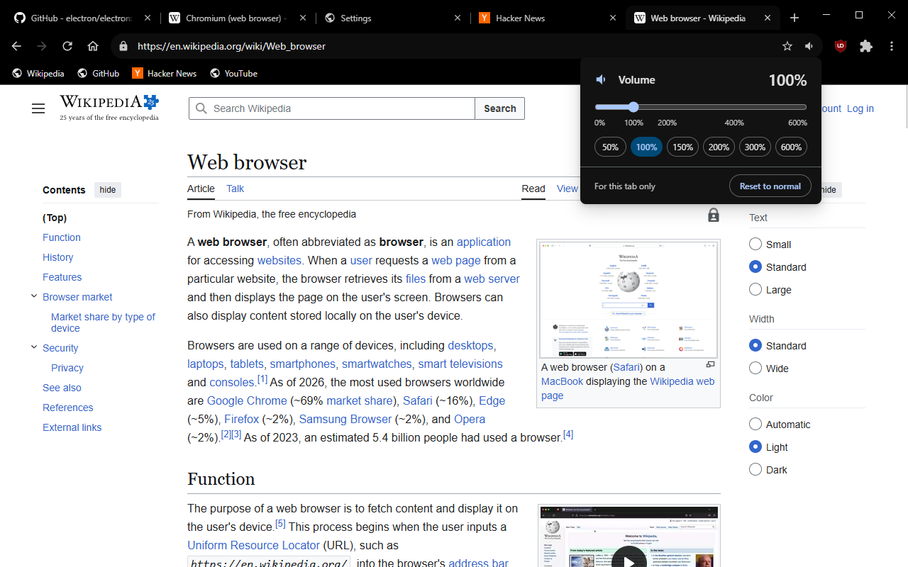 |

| Malicious-site warning |
|---|
| 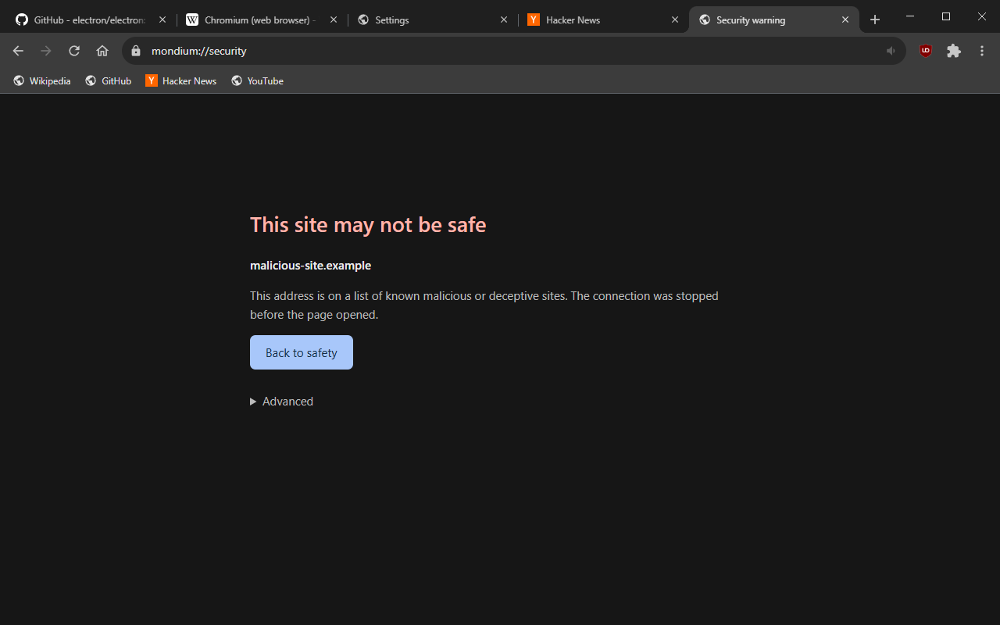 |

> The interface is available in **English** and **Turkish** (Settings → Appearance → Language).

## Features

### Privacy
- **uBlock Origin, built in.** The real, official uBlock Origin (MV2) ships with the browser and cannot be removed by accident. A lighter built-in engine (Ghostery adblocker with uBO lists) is available as an alternative.
- **Google without the tracking.** Non-personalized results (`pws=0`), no AI Overviews (`udm=14`), Google logging and ping requests blocked.
- **Passkeys disabled** on request: no Windows Hello or "use a passkey" pop-ups.
- **DNS-over-HTTPS** (Cloudflare, Quad9), **DNT** and **GPC** on by default.
- **Permission bubbles** like Chrome's for camera, microphone, location, notifications and device access. Your decisions are remembered.
- **Incognito windows** with a separate in-memory session, wiped when the last one closes.

### Protected sites
Clear everything, except the sites you choose to keep signed in to.
- Protect a site from the settings page, the site data list, or the address bar's site menu.
- Cleanup works per cookie and per storage key through the engine itself. Third-party data embedded *inside* a protected site (CHIPS / partitioned storage) is kept, and the same third party embedded elsewhere is removed.
- A real inventory of cookies and site storage (IndexedDB, Cache Storage, service workers, OPFS, localStorage), read from the engine, not from history.
- Every cleanup is verified by re-reading the inventory: requested vs. deleted vs. remaining.
- Handles public suffixes, private suffixes (`github.io`), IDN domains, IP addresses and `localhost`.

### Memory
- **Deferred background tabs.** A link opened in the background is only a title until you select it: no renderer, scripts or media.
- **Blocking saves memory too.** Ads and trackers that never load never get a process. In our test with six popular sites (Windows, full site isolation), Mondium settled at about 1.2 GB in 14 processes. With blocking broken (the 1.4.0 bug), the same sites took 2.0 GB in 39 processes.
- **Extra memory saving (optional).** Settings → Performance makes the JavaScript engine favor memory over speed: about 5% less RAM on the same test, possibly a little slower on heavy sites.
- **Process grouping (optional).** Full site isolation is on by default. Turning it off lets regular sites share processes while sign-in, payment and protected sites stay isolated. With ads blocked it saves little: about 50–150 MB on the same six sites.
- **Tab sleeping.** Background tabs are unloaded after 5–60 minutes (configurable), or by hand from the tab menu or task manager. Tabs playing audio are never put to sleep automatically.
- **Lazy session restore.** Only the active tab loads at startup.
- **Task manager** (`Shift+Esc`) shows the memory and CPU of every tab, extension and process.

### Interface
- **Vertical tabs** with a resizable sidebar (down to an icon-only strip), a grid of pinned tabs and an auto-hide mode (`Ctrl+S`). The sidebar slides in from the screen edge.
- **Themes:** System, Light, Dark, 19 color themes, and an optional **pitch-black** mode for OLED screens.
- **New tab page:** your shortcuts, the Mondium logo and a clock you can place above the logo or in any corner, with adjustable size, font and weight.
- **Built-in tools, no extensions needed:** a volume booster (up to 600% per tab), hover zoom for images (press `Z` to pin and zoom with the wheel, `S` to download), reader mode (`F9`), picture-in-picture.
- **Import bookmarks** from Chrome, Edge, Brave, Opera, Vivaldi, Yandex or Firefox in one click, or from any exported HTML file. Read locally, nothing is sent anywhere; imports land in a folder on the bookmarks bar.
- **Address bar suggestions** from local history and bookmarks only. Nothing you type is sent to a search engine until you press Enter.
- Chrome keyboard shortcuts, tab pinning and muting, reopen closed tabs, bookmarks bar, downloads and history pages.
- **Updates when you want them.** Settings → About Mondium checks GitHub for a new version and shows a dot on the ⋮ button when there is one. Nothing is installed until you click **Update**. Each system updates its own way: the Windows installer, the macOS app, the Linux `.deb` (asks your password) or AppImage, always verified against the SHA-256 that GitHub lists for the file.

### Compatibility
- **Chrome Web Store extensions** can be installed directly, and you can manage, hide and remove them from a Chrome-like extensions page.
- **Widevine DRM** through castLabs Electron.
- **WebHID, WebUSB, Web Serial and Web Bluetooth** for web-based device configurators and firmware flashers.
- Codecs: H.264, HEVC (hardware), VP9, AV1, AAC, Opus, MP3. Built-in PDF viewer.

## Download

**[⬇ Download the latest Mondium](https://github.com/mondieuu/mondium/releases/latest)** and pick your file under *Assets*:

| System | File |
|---|---|
| Windows 10/11 (64-bit) | `Mondium-Setup-<version>.exe` |
| macOS, Apple Silicon | `Mondium-<version>-mac-arm64.dmg` |
| macOS, Intel | `Mondium-<version>-mac-x64.dmg` |
| Debian, Ubuntu and similar (64-bit) | `Mondium-<version>-linux-amd64.deb` |
| Other Linux (64-bit) | `Mondium-<version>-linux-x86_64.AppImage` |

**Windows:** the installer works like Chrome's: one click, no admin rights, installs for the current user and opens Mondium when it's done. You can make it your default browser under **Settings → Apps → Default apps**.

> The installer is not code-signed yet, so Windows SmartScreen may show a warning. Click **More info → Run anyway**.

**macOS:** open the disk image and drag Mondium to Applications. You can make it your default browser under **System Settings → Desktop & Dock**.

> The app is not notarized by Apple, so macOS may say it is damaged or can't be checked. After moving it to Applications, run this once in Terminal:
>
> ```bash
> xattr -cr /Applications/Mondium.app
> ```

**Linux:** install the `.deb` with the command below, or make the AppImage executable and run it. Mondium is listed as a web browser, so you can choose it in your system's default applications.

```bash
sudo apt install ./Mondium-<version>-linux-amd64.deb
```

> On Ubuntu 23.10 and newer, use the `.deb`: the system's AppArmor rules stop AppImages from starting Chromium's sandbox. Mondium doesn't turn the sandbox off to get around this.

## Build from source

Requirements: [Node.js](https://nodejs.org/) 22 or newer on Windows, macOS or Linux.

```bash
git clone https://github.com/mondieuu/mondium.git
cd mondium
npm install
npm start
```

Build the installer for your system into `dist/`. On Windows you can also run `build-installer.bat`.

```bash
npm run dist:win
```

```bash
npm run dist:mac
```

```bash
npm run dist:linux
```

Every version tag builds all of them in GitHub Actions and tests the real installers on each system ([workflow](.github/workflows/build.yml)).

Update the bundled uBlock Origin to the latest release:

```bash
npm run update-ublock
```

### Optional: streaming services
Netflix, Disney+ and similar services require a production Widevine VMP signature. Create a free [castLabs EVS](https://github.com/castlabs/electron-releases/wiki/EVS) account once (`vmp-create-account.bat`). After that, installers are signed automatically.

## Project structure

| File | Purpose |
|---|---|
| `main.js` | Main process: windows and tabs, permissions, ad blocking, extensions, themes, sessions |
| `ui.html` | Tab strip, toolbar, menus and bubbles, all drawn in one view |
| `site-data.js` | Protected sites: site rules, engine inventory, selective cleanup |
| `settings.html`, `newtab.html`, `history.html`, `downloads.html`, `extensions.html`, `taskmanager.html`, `securitywarning.html` | Internal pages |
| `secure-crx.js`, `bounded-fetch.js`, `threat-protection.js`, `private-ubo.js` | Extension package verification, size-limited downloads, malicious-site list, Incognito network filter |
| `updater.js` | Update check and install from GitHub releases, per operating system |
| `volume.js`, `hoverzoom.js`, `reader.js` | Built-in tools injected into isolated worlds |
| `page-preload.js` | Small preload for all pages |
| `i18n.js` | English translations of the UI (Turkish is the source language) |
| `bookmark-import.js` | Bookmark import from other browsers |
| `vendor/ublock` | Bundled uBlock Origin |

## Privacy note

Mondium has no server and collects nothing. The update check asks GitHub at most once a day from a separate session without your cookies, so GitHub sees only your IP address; you can turn it off in Settings. All data (settings, history, downloads, cookies) stays on your machine: in `%APPDATA%\Mondium` on Windows, `~/Library/Application Support/Mondium` on macOS and `~/.config/Mondium` on Linux.

## License

[GPL-3.0](LICENSE). See [NOTICE](NOTICE.md) for attribution, including the security work ported from [Calcium](https://github.com/cnrgks/Calcium). Mondium bundles [uBlock Origin](https://github.com/gorhill/uBlock) (GPL-3.0) and is built with [Electron](https://www.electronjs.org/) / [castLabs ECS](https://github.com/castlabs/electron-releases), [electron-chrome-extensions](https://github.com/samuelmaddock/electron-browser-shell) and [Ghostery adblocker](https://github.com/ghostery/adblocker).

Mondium is not affiliated with Google or the Chromium project.

---

## Türkçe

**Mondium**, Chromium tabanlı, sade ve gereksiz her şeyden arındırılmış (debloated) bir masaüstü tarayıcı. Hesap yok, telemetri yok, şişkinlik yok: RAM'inize ve gizliliğinize saygı duyan hızlı, sessiz bir tarayıcı. Arayüz **Türkçe** ve **İngilizce** (Ayarlar → Görünüm → Dil).

### Neden Mondium
- **Arındırılmış:** Oturum açma, senkronizasyon, çökme raporu, Safe Browsing pingleri, çeviri servisi, Privacy Sandbox, Topics ve FLEDGE yok. `X-Client-Data` başlığı yok.
- **Az RAM:** Arka plan sekmeleri açılana kadar yüklenmez, kullanılmayan sekmeler uyur, arayüz ek süreç açmaz.
- **Varsayılan olarak gizli:** Gerçek uBlock Origin içinde gelir; DNS-over-HTTPS, Do Not Track + Global Privacy Control, WebRTC IP sızıntısı koruması.
- **Güçlendirilmiş:** Tam site izolasyonu, sandbox'lı arayüz, imzası doğrulanan uzantı paketleri ve yerel zararlı site uyarısı. Ayrıntı: [güvenlik notları](docs/security-hardening.md).
- **Sade tasarım:** Chrome'a benzeyen düzen, logolar olmadan. 22 tema, tam siyah (pitch black) mod, dikey sekmeler.
- **Saf JavaScript:** Arayüzün tamamı düz HTML, CSS ve JavaScript. Framework, bundler ya da TypeScript yok.

### Öne çıkanlar
- **Korunan siteler:** Gezinti verilerini temizlerken seçtiğiniz sitelerde oturumunuz açık kalır. Temizlik motor üzerinden çerez ve depolama anahtarı bazında yapılır, sonuç yeniden okunarak doğrulanır.
- **Bellek:** Reklam ve izleyiciler hiç yüklenmediği için süreç de açmaz. 6 popüler sitede yaklaşık 1,2 GB ve 14 süreç. Ayarlar → Performans → **Ekstra bellek tasarrufu** yaklaşık %5 daha kazandırır, ağır sitelerde biraz yavaşlatabilir. Tam site izolasyonu varsayılan olarak açık; kapatmak artık az kazandırır (aynı testte 50–150 MB).
- **Yerleşik araçlar:** Ses yükseltme (sekme başına %600'e kadar), resim büyütme (`Z` ile sabitle, tekerlekle yakınlaştır, `S` ile indir), okuma modu (`F9`), resim içinde resim.
- **Yer işareti aktarma:** Chrome, Edge, Brave, Opera, Vivaldi, Yandex veya Firefox'tan tek tıkla ya da HTML dosyasından. Dosyalar sadece bu bilgisayarda okunur.
- **Uyumluluk:** Chrome Web Mağazası uzantıları, Widevine DRM, WebHID / WebUSB / Web Serial / Web Bluetooth, yerleşik PDF görüntüleyici.
- **Güncelleme size bağlı:** Ayarlar → Mondium hakkında GitHub'dan yeni sürümü denetler, varsa ⋮ düğmesinde nokta görünür. **Güncelle**'ye basmadan hiçbir şey kurulmaz. Her sistem kendi yöntemiyle güncellenir: Windows kurulum dosyası, macOS uygulaması, Linux `.deb` (parola sorar) ya da AppImage. Dosya, GitHub'ın verdiği SHA-256 ile doğrulanır.

### İndir
**[⬇ En son Mondium'u indir](https://github.com/mondieuu/mondium/releases/latest)** ve *Assets* altından sisteminize uygun dosyayı seçin:

| Sistem | Dosya |
|---|---|
| Windows 10/11 (64 bit) | `Mondium-Setup-<sürüm>.exe` |
| macOS, Apple Silicon | `Mondium-<sürüm>-mac-arm64.dmg` |
| macOS, Intel | `Mondium-<sürüm>-mac-x64.dmg` |
| Debian, Ubuntu ve benzerleri (64 bit) | `Mondium-<sürüm>-linux-amd64.deb` |
| Diğer Linux dağıtımları (64 bit) | `Mondium-<sürüm>-linux-x86_64.AppImage` |

**Windows:** Kurulum Chrome'unki gibi: tek tık, yönetici izni gerekmez, bitince Mondium açılır. **Ayarlar → Uygulamalar → Varsayılan uygulamalar** bölümünden varsayılan tarayıcı yapabilirsiniz.

> Kurulum dosyası henüz kod imzalı değil, Windows SmartScreen uyarı verebilir. **Ek bilgi → Yine de çalıştır** seçeneğine tıklayın.

**macOS:** Disk görüntüsünü açıp Mondium'u Uygulamalar klasörüne sürükleyin. **Sistem Ayarları → Masaüstü ve Dock** bölümünden varsayılan tarayıcı yapabilirsiniz.

> Uygulama Apple tarafından onaylanmış (notarized) değil, macOS "hasarlı" ya da "denetlenemiyor" diyebilir. Uygulamalar klasörüne taşıdıktan sonra Terminal'de bir kez şunu çalıştırın:
>
> ```bash
> xattr -cr /Applications/Mondium.app
> ```

**Linux:** `.deb` dosyasını aşağıdaki komutla kurun ya da AppImage dosyasını çalıştırılabilir yapıp açın. Mondium web tarayıcısı olarak listelenir, sistemin varsayılan uygulamalar bölümünden seçebilirsiniz.

```bash
sudo apt install ./Mondium-<sürüm>-linux-amd64.deb
```

> Ubuntu 23.10 ve sonrasında `.deb` kullanın: sistemin AppArmor kuralları AppImage'ların Chromium korumalı alanını (sandbox) başlatmasını engelliyor. Mondium bunu aşmak için korumalı alanı kapatmaz.

### Kaynaktan derleme
```bash
git clone https://github.com/mondieuu/mondium.git
cd mondium
npm install
npm start
```
Kurulum dosyası için `npm run dist:win`, `npm run dist:mac` ya da `npm run dist:linux`.

### Gizlilik notu
Mondium'un sunucusu yok ve hiçbir veri toplamaz. Güncelleme denetimi günde en fazla bir kez, çerezleriniz olmadan ayrı bir oturumdan GitHub'a sorar; GitHub sadece IP adresinizi görür, Ayarlar'dan kapatabilirsiniz. Ayarlar, geçmiş, indirmeler ve çerezler bilgisayarınızda kalır: Windows'ta `%APPDATA%\Mondium`, macOS'ta `~/Library/Application Support/Mondium`, Linux'ta `~/.config/Mondium`.

Lisans: [GPL-3.0](LICENSE). Kaynak gösterimi için [NOTICE](NOTICE.md). Mondium, Google veya Chromium projesiyle bağlantılı değildir.
